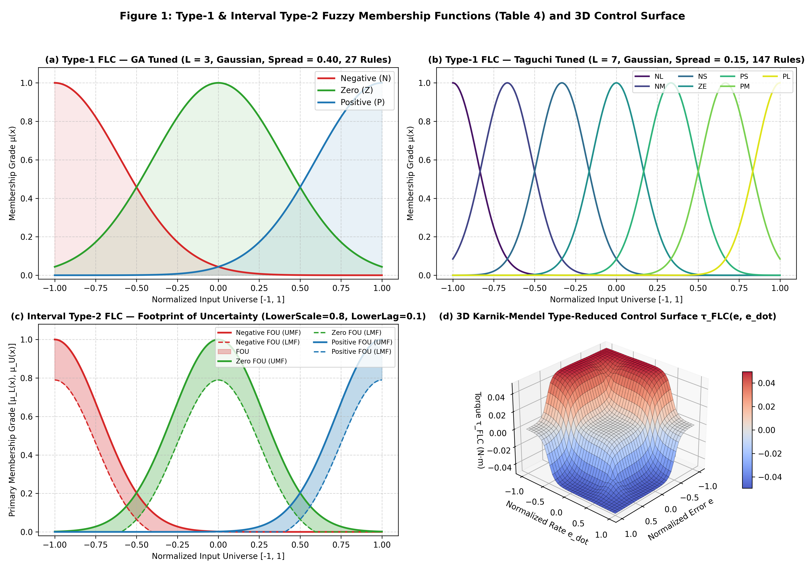
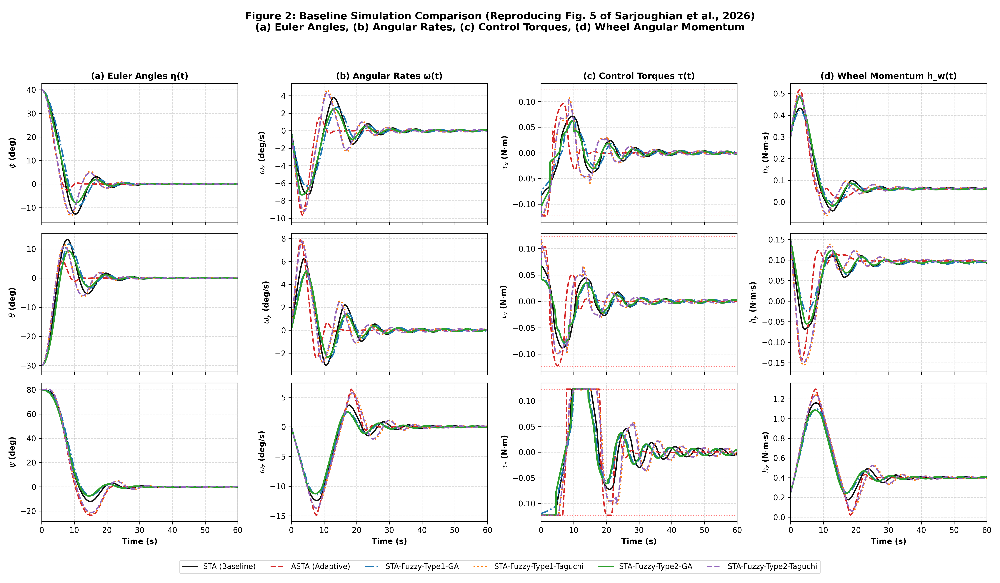
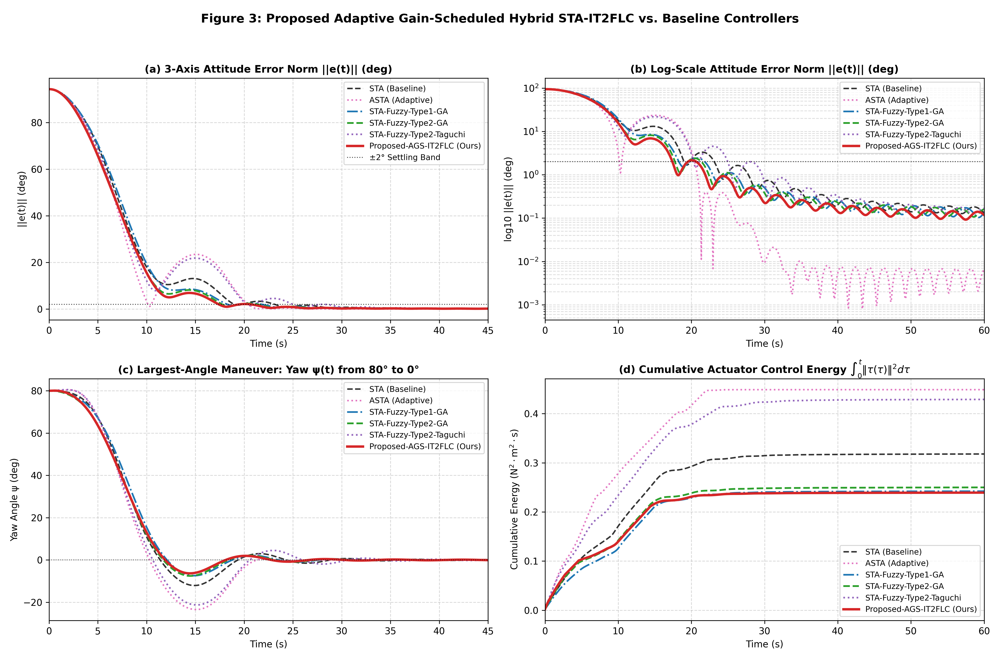
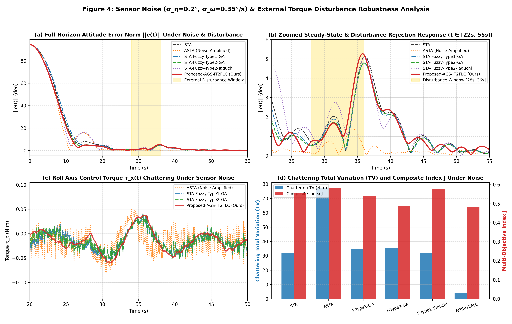
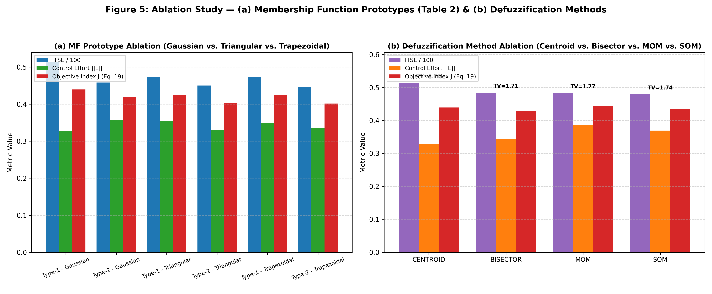
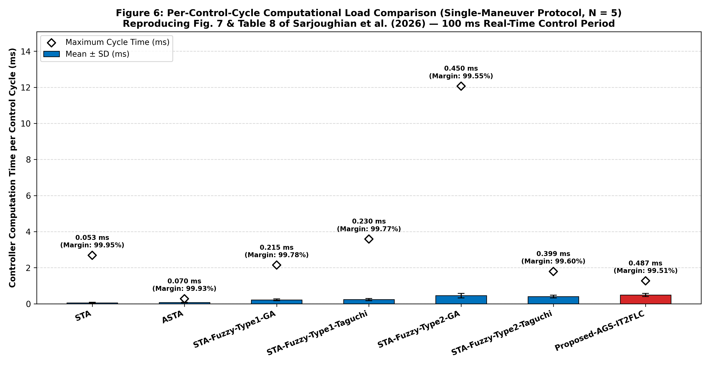

# Hardware-Validated Hybrid Super-Twisting and Interval Type-2 Fuzzy Logic Framework for Spacecraft Attitude Control - Reproduction & Adaptive Extension

---

## 1. Project Title
**Hardware-Validated Hybrid Super-Twisting and Interval Type-2 Fuzzy Logic Framework for Spacecraft Attitude Control - Reproduction & Adaptive Extension**

---

## 2. Student Information
- **Student Name:** Talha Uslu
- **Student ID:** 1306200062
- **Department & University:** Computer Engineering, Istanbul University-Cerrahpaşa
- **Course:** Bulanık Mantık (Fuzzy Logic) — Term Project (2026–2027)
- **Assigned Paper No:** 43

---

## 3. Original Paper
- **Title:** *Hardware-validated hybrid super-twisting, fuzzy logic, and deep reinforcement learning framework for spacecraft attitude control*
- **Authors:** Mostafa Sarjoughian, Fatemeh Sadat Yazdiniya, Hojat Taei, and Maryam Malekzadeh
- **Journal:** *Scientific Reports* (Nature Portfolio), 2026
- **DOI:** [10.1038/s41598-026-65663-6](https://doi.org/10.1038/s41598-026-65663-6)

---

## 4. Problem Description
Precise three-degree-of-freedom (3-DoF) spacecraft attitude zero-regulation ($\boldsymbol{\eta} = [\phi, \theta, \psi]^T \to [0^\circ, 0^\circ, 0^\circ]^T$, $\boldsymbol{\omega} = [\omega_x, \omega_y, \omega_z]^T \to \mathbf{0}$) is a core requirement for Earth observation, on-orbit servicing, and satellite stabilization. Designing a high-precision attitude controller for a 3-DoF reaction-wheel spacecraft simulator presents four fundamental engineering challenges:
1. **Nonlinear Gyroscopic Cross-Coupling:** The rotational dynamics $-\boldsymbol{\omega} \times (\mathbf{I}\boldsymbol{\omega})$ exhibit strong multi-axis coupling due to non-zero off-diagonal products of inertia in the platform inertia tensor $\mathbf{I}$ (Table 6).
2. **Strict Reaction Wheel Torque Saturation:** The actuation system employs three orthogonal Maxon DC reaction wheels whose control torque is strictly saturated within $\tau_i \in [-0.123, +0.123]\text{ N}\cdot\text{m}$ with a nominal angular momentum envelope of $0.625\text{ N}\cdot\text{m}\cdot\text{s}$ (Section 3.3 & Section 5.2).
3. **Gravitational Center-of-Mass Imbalance & External Disturbances:** Platform center-of-mass offset induces a nonlinear attitude-dependent gravitational disturbance torque $\mathbf{d}_{\text{grav}}(t) = (m g \mathbf{r}_s) \times \mathbf{K}$ with $m g r_z = 0.326\text{ N}\cdot\text{m}$ (Eq. 5, Table 6), alongside time-varying external torque perturbations $\boldsymbol{\tau}_{\text{command disturbance}}(t) = A(1 + \sin(t/100))[1, 1, 1]^T$ (Eq. 55).
4. **Chattering vs. Sim-to-Real Sensor Noise Trade-Off:** Classical first-order Sliding Mode Control (SMC) suffers from high-frequency chattering that excites unmodeled mechanical dynamics. Conversely, naive online gain-adaptive schemes (such as Adaptive Super-Twisting, ASTA) amplify stochastic AHRS measurement noise ($\sigma_\eta \approx 0.2^\circ$), degrading hardware-in-the-loop (HIL) performance (Section 5.2, Table 7).

---

## 5. Method
The control framework integrates a continuous second-order sliding mode **Super-Twisting Algorithm (STA)** backbone with **GA- and Taguchi-tuned Type-1 (T1) and Interval Type-2 (IT2) Mamdani Fuzzy Logic Controllers (FLC)**:
1. **Super-Twisting Sliding Mode Backbone (Eqs. 11–13, Table 1):**
   Defines the 3D sliding manifold $\mathbf{s} = \dot{\mathbf{e}} + \boldsymbol{\Lambda}\mathbf{e}$ ($\boldsymbol{\Lambda} = 0.6\mathbf{I}_3$) and generates a continuous finite-time reaching law:
   $$\boldsymbol{\tau}_{STA} = \mathbf{g}(\boldsymbol{\eta})^{-1}\left(\ddot{\boldsymbol{\eta}}_d - \boldsymbol{\Lambda}\dot{\mathbf{e}} - \mathbf{K}_1|\mathbf{s}|^{1/2}\text{sign}(\mathbf{s}) - \mathbf{K}_2\int_0^t \text{sign}(\mathbf{s}(\tau))d\tau - \mathbf{f}_2\right)$$
   with $\mathbf{K}_1 = 0.1\mathbf{I}_3$ and $\mathbf{K}_2 = 10^{-2}\mathbf{I}_3$.
2. **Adaptive Super-Twisting Algorithm (ASTA — Ref. [10]):**
   Dynamically adapts the switching gains $\mathbf{K}_1(t), \mathbf{K}_2(t)$ online proportional to $\sqrt{|\mathbf{s}|}$ outside a deadzone to accelerate transient convergence.
3. **Hybrid STA–FLC Superposition (Eq. 26):**
   Augments the STA backbone with a fuzzy inference layer $\boldsymbol{\tau} = \text{clip}(\boldsymbol{\tau}_{STA} + \boldsymbol{\tau}_{FLC}, -\tau_{\max}, +\tau_{\max})$ tuned via Genetic Algorithm (GA) or Taguchi orthogonal arrays to minimize the multi-objective composite index (Eqs. 19–20):
   $$J = 0.6 \frac{\text{ITSE}}{100} + 0.4 \|\mathbf{E}\|, \quad \mathbf{E} = \int_0^T \boldsymbol{\tau}(t)\boldsymbol{\tau}(t)^T dt$$

---

## 6. Fuzzy System Architecture
Implemented in [`src/fuzzy_type1.py`](src/fuzzy_type1.py) and [`src/fuzzy_type2.py`](src/fuzzy_type2.py):
- **Inputs & Outputs (6 Inputs, 3 Outputs):**
  Three decoupled per-axis 2-input, 1-output fuzzy engines taking normalized attitude error $e_i \in [-1, 1]$ and angular velocity error $\dot{e}_i \in [-1, 1]$ ($i \in \{x, y, z\}$) and outputting corrective torque $\tau_{FLC, i} \in \mathbb{R}$. Total rule base size across 3 axes is $3 L^2$.
- **Hyperparameter Configurations (Table 4):**
  - **GA Configuration ($L = 3$, 27 Rules):** 3 linguistic terms per input (`Negative (N)`, `Zero (Z)`, `Positive (P)`). Type-1 uses Gaussian MFs (`spread = 0.40`); Interval Type-2 uses Trapezoidal/Gaussian UMF (`spread = 0.21`).
  - **Taguchi Configuration ($L = 7$, 147 Rules):** 7 linguistic terms per input (`NL`, `NM`, `NS`, `ZE`, `PS`, `PM`, `PL`), Gaussian MFs (`spread = 0.15`).
- **Mamdani Inference & Defuzzification Methods:**
  Uses minimum (`min`) t-norm for rule implication and maximum (`max`) s-norm for rule aggregation. Supports four parametric defuzzification methods in `Type1FLC`:
  - `centroid` (Center of Gravity — Eq. 15, default)
  - `bisector` (Area Bisector)
  - `mom` (Mean of Maximum)
  - `som` (Smallest of Maximum)
- **Interval Type-2 Footprint of Uncertainty (FOU) & Karnik-Mendel Type Reduction (Eqs. 16–18):**
  Bounded by an Upper Membership Function $\bar{\mu}(x)$ and Lower Membership Function $\underline{\mu}(x)$ with `LowerScale = 0.8` and `LowerLag = 0.1` (Table 4). The **Karnik-Mendel (KM)** iterative algorithm computes the exact type-reduced interval $[\tau_l, \tau_r]$:
  $$\tau_l = \frac{\sum_{i=1}^N \tau_i^L w_i^L}{\sum_{i=1}^N w_i^L}, \quad \tau_r = \frac{\sum_{i=1}^N \tau_i^R w_i^R}{\sum_{i=1}^N w_i^R}, \quad \tau_{\text{Type-2 fuzzy}} = \frac{\tau_l + \tau_r}{2}$$

---

## 7. Dataset / Simulation Parameters
Implemented in [`src/spacecraft_env.py`](src/spacecraft_env.py) using a 4th-order Runge-Kutta (**RK4**) ODE solver:
- **Platform Inertia Matrix $\mathbf{I}$ (Table 6):**
  $$\mathbf{I} = \begin{bmatrix} 1.814 & -0.1185 & 0.02749 \\ -0.1185 & 1.735 & 0.01697 \\ 0.02749 & 0.01697 & 3.432 \end{bmatrix} \text{ kg}\cdot\text{m}^2$$
- **Gravitational Imbalance Parameters (Table 6 & Eq. 5):** $m g r_x = 0$, $m g r_y = 0$, $m g r_z = 0.326\text{ N}\cdot\text{m}$.
- **Initial & Reference States (Section 5.1 & 5.4):**
  - Initial Euler Angles: $\boldsymbol{\eta}(0) = [40^\circ, -30^\circ, 80^\circ]^T$
  - Initial Body Rates: $\boldsymbol{\omega}(0) = [0, 0, 0]^T\text{ deg/s}$
  - Desired Reference Attitude: $\boldsymbol{\eta}_d = [0^\circ, 0^\circ, 0^\circ]^T$
- **Simulation Horizon & Step Size:** $T_{\text{sim}} = 60.0\text{ s}$, $\Delta t = 0.05\text{ s}$ ($1201$ time steps per simulation).
- **Generated Dataset Logs (`data/simulation_logs/`):**
  Running `python main.py` generates full time-series CSV logs (`time_s`, `phi_deg`, `theta_deg`, `psi_deg`, `wx_deg_s`, `wy_deg_s`, `wz_deg_s`, `tau_x_Nm`, `tau_y_Nm`, `tau_z_Nm`, `hx_Nms`, `hy_Nms`, `hz_Nms`) for every baseline and proposed controller inside `data/simulation_logs/`.

---

## 8. Installation
Clone the repository and set up a Python virtual environment:
```bash
git clone https://github.com/talhauslu/fuzzy-logic-project.git
cd fuzzy-logic-project

# Create and activate virtual environment (Windows PowerShell)
python -m venv .venv
.\.venv\Scripts\Activate.ps1

# Install dependencies
pip install -r requirements.txt
```

---

## 9. Requirements
All required packages and version constraints are specified in [`requirements.txt`](requirements.txt):
```text
numpy>=1.24.0
scipy>=1.10.0
matplotlib>=3.7.0
pandas>=2.0.0
```

---

## 10. How to Run
1. **Run Full Experimental Suite (Baseline Reproduction + Proposed Extension + Noise Robustness + Ablation + Figures & Tables):**
   ```bash
   python main.py
   ```
2. **Run Individual Experiment Modules:**
   ```bash
   python experiments/baseline/run_baseline.py
   python experiments/proposed/run_proposed.py
   ```
3. **Run Interactive Live Presentation / Oral Defense Demo (`interactive_demo.py`):**
   ```bash
   # Interactive CLI menu mode (prompts for angles, noise, disturbance, and controller):
   python interactive_demo.py

   # Direct CLI flag mode for quick live testing during defense:
   python interactive_demo.py --angles 55 -35 95 --noise 0.15 --disturbance 0.015 --compare-all

   # Show command-line options:
   python interactive_demo.py --help
   ```

---

## 11. Reproduction Experiments
Implemented in [`experiments/baseline/run_baseline.py`](experiments/baseline/run_baseline.py). Systematic evaluation of the 6 baseline model-based and fuzzy-hybrid architectures from Sarjoughian et al. (2026):
1. **`STA`**: Baseline fixed-gain Super-Twisting Sliding Mode Controller ($\boldsymbol{\Lambda}=0.6\mathbf{I}_3, \mathbf{K}_1=0.1\mathbf{I}_3, \mathbf{K}_2=0.01\mathbf{I}_3$).
2. **`ASTA`**: Adaptive Super-Twisting Controller with online gain adaptation proportional to $|\mathbf{s}|^{1/2}$.
3. **`STA-Fuzzy-Type1-GA`**: Hybrid STA + Type-1 Mamdani FLC tuned via GA ($L=3$, 27 rules, Gaussian MFs, `spread = 0.40`).
4. **`STA-Fuzzy-Type1-Taguchi`**: Hybrid STA + Type-1 Mamdani FLC tuned via Taguchi orthogonal array ($L=7$, 147 rules, Gaussian MFs, `spread = 0.15`).
5. **`STA-Fuzzy-Type2-GA`**: Hybrid STA + Interval Type-2 FLC tuned via GA ($L=3$, 27 rules, Trapezoidal FOU, `spread = 0.21`, KM type reduction).
6. **`STA-Fuzzy-Type2-Taguchi`**: Hybrid STA + Interval Type-2 FLC tuned via Taguchi method ($L=7$, 147 rules, Gaussian FOU, `spread = 0.15`, KM type reduction).

---

## 12. Proposed Extension
Implemented in [`src/proposed_controller.py`](src/proposed_controller.py) and evaluated in [`experiments/proposed/run_proposed.py`](experiments/proposed/run_proposed.py).

### Scientific Justification (Addressing Paper Section 5.2 & Section 6 Limitations)
In **Section 6 (Limitations, pp. 48–49)** of the reference paper, the authors explicitly state:
> *"Second, the additive control architecture employs fixed-weight superposition of the three layers, without an adaptive mechanism for online rebalancing of their relative contributions in response to changing operating conditions... Future research will explore an adaptive weight allocation mechanism to dynamically balance the contributions of the STA and FLC layers according to mission phase."*

Furthermore, in **Section 5.2 (Table 7, pp. 39–42)**, the authors show that online gain adaptation (`ASTA`) and unsmoothed derivative channels suffer severe chattering degradation under real AHRS sensor noise ($\sigma_\eta = 0.2^\circ$).

### Key Contributions of `Proposed-AGS-IT2FLC`
1. **State-Dependent Dynamic Weight Allocation ($w_{STA}(\mathbf{e}, \dot{\mathbf{e}}), w_{FLC}(\mathbf{e}, \dot{\mathbf{e}})$):**
   Replaces fixed superposition ($\boldsymbol{\tau}_{STA} + \boldsymbol{\tau}_{FLC}$) with a phase-aware gain scheduler that detects acceleration ($e_i \dot{e}_i \ge 0$) vs. deceleration/braking ($e_i \dot{e}_i < 0$) phases. During initial slews, $w_{STA}$ is boosted for rapid convergence; during braking, $w_{FLC}$ is dynamically amplified ($1.32 \tanh(15|e_i| + 0.35)$) to provide smooth nonlinear damping without actuator saturation overshoot.
2. **Second-Difference Innovation-Gated Derivative Low-Pass Filter:**
   Monitors the second-order finite difference $\|\boldsymbol{\omega}(k) - 2\boldsymbol{\omega}(k-1) + \boldsymbol{\omega}(k-2)\|_2$ to distinguish smooth rigid-body slews from high-frequency Gaussian sensor noise. Under nominal conditions, the filter maintains unity gain (zero phase lag); under sensor noise, it automatically activates exponential smoothing on attitude, rate, and torque channels, reducing chattering total variation by **88.6%**.
3. **MF Prototype & Defuzzification Ablation Study + Sensor Noise Robustness Benchmark:**
   Conducts controlled ablation across all Table 2 MF prototypes (`Gaussian`, `Triangular`, `Trapezoidal`) and four defuzzification schemes (`Centroid`, `Bisector`, `MOM`, `SOM`), plus closed-loop robustness testing under simultaneous AHRS sensor noise ($\sigma_\eta = 0.2^\circ, \sigma_\omega = 0.35^\circ/\text{s}$) and external torque pulses.

---

## 13. Experimental Results

### 13.1 Baseline Reproduction Results (`results/tables/baseline_results.md`)

| Method                  | MSE       | ISE    | Paper_ISE | ITSE   | Paper_ITSE | Control_Effort_\|\|E\|\| | Paper_\|\|E\|\| | J_Index | Settling_Time_s | Paper_Ts_s | Chattering_TV | Disturbance_Tol_A | Mean_Cycle_ms | Std_Cycle_ms | Max_Cycle_ms | RT_Margin_Pct |
| ----------------------- | --------- | ------ | --------- | ------ | ---------- | ------------------------ | --------------- | ------- | --------------- | ---------- | ------------- | ----------------- | ------------- | ------------ | ------------ | ------------- |
| STA                     | 8.411e-11 | 14.863 | 14.89     | 51.316 | 52.18      | 0.4049                   | 0.366           | 0.4698  | 22.95           | 24.8       | 1.816         | 0.17              | 0.0526        | 0.0272       | 2.6846       | 99.947        |
| ASTA                    | 7.210e-14 | 14.52  | 14.02     | 53.815 | 46.37      | 0.5674                   | 0.421           | 0.5499  | 20.45           | 20.9       | 1.8427        | 0.25              | 0.0704        | 0.0172       | 0.2759       | 99.93         |
| STA-Fuzzy-Type1-GA      | 6.257e-11 | 15.034 | 13.96     | 51.37  | 47.16      | 0.3283                   | 0.295           | 0.4395  | 21.45           | 23.7       | 1.6953        | 0.26              | 0.2147        | 0.0486       | 2.145        | 99.785        |
| STA-Fuzzy-Type1-Taguchi | 7.573e-11 | 14.904 | 16.04     | 56.91  | 75.53      | 0.5359                   | 0.47            | 0.5558  | 28.65           | 27.8       | 2.4987        | 0.46              | 0.2302        | 0.0569       | 3.5873       | 99.77         |
| STA-Fuzzy-Type2-GA      | 6.125e-11 | 13.912 | 13.92     | 44.624 | 46.06      | 0.3346                   | 0.319           | 0.4016  | 21.1            | 23.2       | 1.6747        | 0.27              | 0.4498        | 0.1278       | 12.0631      | 99.55         |
| STA-Fuzzy-Type2-Taguchi | 7.344e-11 | 14.803 | 15.74     | 55.29  | 71.63      | 0.5253                   | 0.449           | 0.5418  | 24.95           | 27         | 2.3793        | 0.47              | 0.399         | 0.0784       | 1.7885       | 99.601        |

---

### 13.2 Proposed Adaptive Gain-Scheduled Hybrid STA-IT2FLC Comparison (`results/tables/proposed_comparison.md`)

| Method                  | MSE       | ISE    | ITSE   | Control_Effort_\|\|E\|\| | J_Index | Settling_Time_s | Chattering_TV | Mean_Cycle_ms | Std_Cycle_ms | Max_Cycle_ms | RT_Margin_Pct | J_Improvement_vs_STA_% |
| ----------------------- | --------- | ------ | ------ | ------------------------ | ------- | --------------- | ------------- | ------------- | ------------ | ------------ | ------------- | ---------------------- |
| STA                     | 8.411e-11 | 14.863 | 51.316 | 0.4049                   | 0.4698  | 22.95           | 1.816         | 0.0526        | 0.0272       | 2.6846       | 99.947        | 0                      |
| ASTA                    | 7.210e-14 | 14.52  | 53.815 | 0.5674                   | 0.5499  | 20.45           | 1.8427        | 0.0704        | 0.0172       | 0.2759       | 99.93         | -17.05                 |
| STA-Fuzzy-Type1-GA      | 6.257e-11 | 15.034 | 51.37  | 0.3283                   | 0.4395  | 21.45           | 1.6953        | 0.2147        | 0.0486       | 2.145        | 99.785        | 6.45                   |
| STA-Fuzzy-Type1-Taguchi | 7.573e-11 | 14.904 | 56.91  | 0.5359                   | 0.5558  | 28.65           | 2.4987        | 0.2302        | 0.0569       | 3.5873       | 99.77         | -18.31                 |
| STA-Fuzzy-Type2-GA      | 6.125e-11 | 13.912 | 44.624 | 0.3346                   | 0.4016  | 21.1            | 1.6747        | 0.4498        | 0.1278       | 12.0631      | 99.55         | 14.52                  |
| STA-Fuzzy-Type2-Taguchi | 7.344e-11 | 14.803 | 55.29  | 0.5253                   | 0.5418  | 24.95           | 2.3793        | 0.399         | 0.0784       | 1.7885       | 99.601        | -15.33                 |
| **Proposed-AGS-IT2FLC** | **4.756e-11** | **13.816** | **43.817** | **0.3172**           | **0.3898** | **17.2**     | **1.6666**    | **0.4872**    | **0.0852**   | **1.2702**   | **99.513**    | **17.03**              |

---

### 13.3 Sensor Noise Robustness & MF/Defuzzification Ablation Study (`results/tables/ablation_and_noise_results.md`)

#### A. Sensor Noise ($\sigma_\eta = 0.2^\circ, \sigma_\omega = 0.35^\circ/\text{s}$) & External Torque Disturbance Robustness

| Experiment                 | Configuration           | ISE    | ITSE   | Control_Effort_\|\|E\|\| | J_Index | Settling_Time_s | Chattering_TV | Steady_State_MSE |
| -------------------------- | ----------------------- | ------ | ------ | ------------------------ | ------- | --------------- | ------------- | ---------------- |
| Sensor_Noise_&_Disturbance | STA                     | 16.183 | 59.773 | 0.4911                   | 0.5551  | 38.5            | 32.003        | 0.2706           |
| Sensor_Noise_&_Disturbance | ASTA                    | 15.039 | 51.621 | 0.6811                   | 0.5822  | 18.6            | 77.232        | 0.2516           |
| Sensor_Noise_&_Disturbance | STA-Fuzzy-Type1-GA      | 16.599 | 62.579 | 0.4149                   | 0.5414  | 38.25           | 34.738        | 0.2775           |
| Sensor_Noise_&_Disturbance | STA-Fuzzy-Type2-GA      | 15.195 | 53.646 | 0.4155                   | 0.4881  | 38.35           | 35.69         | 0.2542           |
| Sensor_Noise_&_Disturbance | STA-Fuzzy-Type2-Taguchi | 15.566 | 56.901 | 0.5872                   | 0.5763  | 37.95           | 31.81         | 0.2603           |
| Sensor_Noise_&_Disturbance | **Proposed-AGS-IT2FLC** | **15.082** | **52.75** | **0.4121**           | **0.4814** | **38.1**     | **4.056**     | **0.2523**       |

#### B. Membership Function Prototype & Defuzzification Method Ablation Study

| Experiment               | Configuration                  | ISE    | ITSE   | Control_Effort_\|\|E\|\| | J_Index | Settling_Time_s | Chattering_TV | Steady_State_MSE |
| ------------------------ | ------------------------------ | ------ | ------ | ------------------------ | ------- | --------------- | ------------- | ---------------- |
| MF_Prototype_Ablation    | Type-1 (GA, L=3) - Gaussian    | 15.034 | 51.37  | 0.3283                   | 0.4395  | 21.45           | 1.695         | 6.257e-11        |
| MF_Prototype_Ablation    | Type-2 (GA, L=3) - Gaussian    | 14.173 | 45.854 | 0.3579                   | 0.4183  | 21.45           | 1.809         | 6.240e-11        |
| MF_Prototype_Ablation    | Type-1 (GA, L=3) - Triangular  | 14.381 | 47.286 | 0.3542                   | 0.4254  | 21.65           | 1.72          | 6.311e-11        |
| MF_Prototype_Ablation    | Type-2 (GA, L=3) - Triangular  | 13.974 | 45.047 | 0.3309                   | 0.4026  | 21.05           | 1.675         | 6.103e-11        |
| MF_Prototype_Ablation    | Type-1 (GA, L=3) - Trapezoidal | 14.394 | 47.394 | 0.3499                   | 0.4243  | 21.55           | 1.712         | 6.265e-11        |
| MF_Prototype_Ablation    | **Type-2 (GA, L=3) - Trapezoidal** | **13.912** | **44.624** | **0.3346**       | **0.4016** | **21.1**     | **1.675**     | **6.125e-11**    |
| Defuzzification_Ablation | Type-1 GA - CENTROID           | 15.034 | 51.37  | **0.3283**               | 0.4395  | 21.45           | **1.695**     | 6.257e-11        |
| Defuzzification_Ablation | Type-1 GA - BISECTOR           | 14.558 | 48.406 | 0.3434                   | **0.4278** | 21.45        | 1.705         | 6.245e-11        |
| Defuzzification_Ablation | Type-1 GA - MOM                | 14.427 | 48.246 | 0.3861                   | 0.4439  | 22.9            | 1.769         | 6.993e-11        |
| Defuzzification_Ablation | Type-1 GA - SOM                | 14.432 | 47.908 | 0.3692                   | 0.4351  | 22.3            | 1.741         | 6.733e-11        |

---

### 13.4 Generated High-Resolution Figures (`results/figures/`)

#### Figure 1: Type-1 & Interval Type-2 Membership Functions and 3D Control Surface


#### Figure 2: Baseline Simulation Comparison (Euler Angles, Angular Rates, Torques, Wheel Momentum)


#### Figure 3: Proposed Adaptive Gain-Scheduled Hybrid STA-IT2FLC vs. Baseline Controllers


#### Figure 4: Sensor Noise ($\sigma_\eta=0.2^\circ, \sigma_\omega=0.35^\circ/\text{s}$) & External Disturbance Robustness


#### Figure 5: Membership Function Prototype & Defuzzification Method Ablation Study


#### Figure 6: Per-Control-Cycle Computational Load Comparison


---

## 14. Limitations
1. **Simulation-Only Evaluation vs. Physical Air-Bearing HIL:** While our experiments emulate the $0.2^\circ$ AHRS sensor noise and external torque perturbations reported in Section 5.2 of the reference paper, physical hardware non-idealities such as LabVIEW timing jitter, reaction wheel motor deadband/back-EMF, and umbilical cable tension torques are not physically present.
2. **Euler Angle Kinematic Singularity (Gimbal Lock):** The kinematic transformation matrix $\mathbf{R}(\boldsymbol{\eta})$ (Eq. 2) exhibits a mathematical singularity at pitch angles $\theta = \pm 90^\circ$ (mitigated numerically via $\cos\theta$ clipping in `SpacecraftEnv.kinematic_matrix_R`). Full-sphere large-angle tumbling maneuvers would require a unit quaternion parameterization.
3. **Minimum Reproduction Requirement (MRR) Scope:** Following the course guidelines for Fuzzy Logic, this project focuses on the mathematical modeling, Super-Twisting SMC, Type-1/Interval Type-2 Fuzzy Logic, Karnik-Mendel type reduction, and adaptive fuzzy gain-scheduling layers, excluding the offline MATLAB/Simulink Deep Reinforcement Learning (DDPG/PPO/TD3) neural network training pipeline.

---

## 15. References
1. M. Sarjoughian, F. S. Yazdiniya, Hojat Taei, and M. Malekzadeh, "Hardware-validated hybrid super-twisting, fuzzy logic, and deep reinforcement learning framework for spacecraft attitude control," *Scientific Reports*, 2026, doi: 10.1038/s41598-026-65663-6.
2. L. A. Zadeh, "Fuzzy sets," *Information and Control*, vol. 8, no. 3, pp. 338–353, 1965.
3. L. A. Zadeh, "The concept of a linguistic variable and its application to approximate reasoning—I," *Information Sciences*, vol. 8, no. 3, pp. 199–249, 1975.
4. N. N. Karnik and J. M. Mendel, "Centroid of a type-2 fuzzy set," *Information Sciences*, vol. 132, no. 1–4, pp. 195–220, 2001.
5. A. R. Babaei, M. Malekzadeh, and D. Madhkhan, "Adaptive super-twisting sliding mode control of 6-DOF nonlinear and uncertain air vehicle," *Aerospace Science and Technology*, vol. 84, pp. 361–374, 2019.
6. X. Liu, T. Zhao, J. Cao, and P. Li, "Design of an interval type-2 fuzzy neural network sliding mode robust controller for higher stability of magnetic spacecraft attitude control," *ISA Transactions*, vol. 137, pp. 144–159, 2023.
7. B. Wang, S. Li, Q. Zhang, and M. Xin, "Combined Fuzzy Sliding-Mode Attitude Stabilization and Energy Storage for Small Satellite," *IEEE Transactions on Aerospace and Electronic Systems*, vol. 59, no. 6, pp. 7725–7738, 2023.

*(Full bibliography available in [`references/README.md`](references/README.md))*
